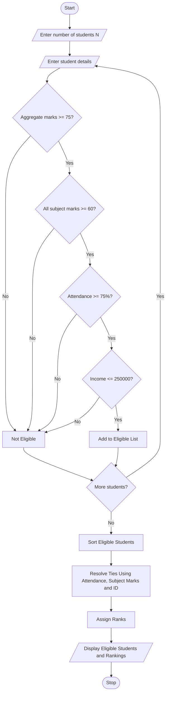

# Problem Statement
Design a University Scholarship Allocation System that evaluates students based on their aggregate marks, subject-wise minimum scores, attendance percentage, and family income. The system should identify eligible students by checking all the required conditions, rank eligible students according to their aggregate marks, and resolve ties using predefined rules such as higher attendance and higher subject marks. Finally, the system should display the scholarship-eligible students and their rankings.
#  Assumptions
1. Each student has a unique student ID.
2. Minimum aggregate marks required are 75%.
3. Minimum marks in each subject must be 60%.
4. Minimum attendance required is 75%.
5. Annual family income must not exceed ₹2,50,000.
6. Students must satisfy all eligibility conditions.
7. Eligible students are ranked according to aggregate marks in descending order.
8. If aggregate marks are equal, higher attendance gets priority.
9. If attendance is also equal, higher subject marks get priority.
10. If all criteria are equal, the student with the lower student ID gets priority.
# Algorithm
1. Start.
2. Read the number of students.
3. For each student, read student ID, name, aggregate marks, subject-wise marks, attendance percentage and annual family income.
4. Check whether aggregate marks are at least 75%.
5. Check whether every subject mark is at least 60%.
6. Check whether attendance is at least 75%.
7. Check whether annual family income is at most ₹2,50,000.
8. If all conditions are satisfied, add the student to the eligible list.
9. Otherwise, mark the student as not eligible.
10. Sort eligible students based on:
    - Higher aggregate marks.
    - Higher attendance percentage.
    - Higher subject marks.
    - Lower student ID.
11. Assign ranks to eligible students.
12. Display the eligible students and their ranks.
13. Stop.
# Mermaid Flowchart

# pseudocode
START

INPUT N
CREATE eligible_list

FOR i = 1 TO N

    INPUT student_id
    INPUT name
    INPUT aggregate_marks
    INPUT subject_marks
    INPUT attendance
    INPUT annual_income

    IF aggregate_marks >= 75 AND
       all subject_marks >= 60 AND
       attendance >= 75 AND
       annual_income <= 250000 THEN

        ADD student to eligible_list

    ELSE
        DISPLAY "Not Eligible"
    END IF

END FOR

SORT eligible_list BY
    aggregate_marks DESCENDING
    attendance DESCENDING
    total_subject_marks DESCENDING
    student_id ASCENDING

ASSIGN RANKS

DISPLAY eligible_list

STOP
# source code
students = []
n = int(input("Enter number of students: "))

for i in range(n):
    print("\nEnter details of student", i + 1)

    sid = int(input("Student ID: "))
    name = input("Student Name: ")
    aggregate = float(input("Aggregate Marks: "))

    subjects = []
    for j in range(3):
        marks = float(input("Enter subject marks: "))
        subjects.append(marks)

    attendance = float(input("Attendance Percentage: "))
    income = float(input("Annual Family Income: "))

    if (aggregate >= 75 and
        all(mark >= 60 for mark in subjects) and
        attendance >= 75 and income <= 250000):

        students.append({
            "id": sid,
            "name": name,
            "aggregate": aggregate,
            "subjects": subjects,
            "attendance": attendance
        })

    else:
        print(name, "- Not Eligible")

# Ranking eligible students
students.sort(key=lambda s: (
    -s["aggregate"],
    -s["attendance"],
    -sum(s["subjects"]),
    s["id"]
))

print("\n--- Scholarship Eligible Students ---")

for rank, s in enumerate(students, start=1):
    print("\nRank:", rank)
    print("ID:", s["id"])
    print("Name:", s["name"])
    print("Aggregate:", s["aggregate"])
    print("Attendance:", s["attendance"])
    print("Subject Total:", sum(s["subjects"]))

if len(students) == 0:
    print("No eligible students found.")
# sample input
Enter number of students: 2

Student 1:
Student ID: 101
Student Name: Ravi
Aggregate Marks: 90
Subject Marks: 85, 90, 95
Attendance: 90
Annual Income: 200000

Student 2:
Student ID: 102
Student Name: Priya
Aggregate Marks: 85
Subject Marks: 80, 90, 85
Attendance: 95
Annual Income: 150000
# sample output
--- Scholarship Eligible Students ---

Rank: 1
ID: 101
Name: Ravi
Aggregate: 90
Attendance: 90
Subject Total: 270

Rank: 2
ID: 102
Name: Priya
Aggregate: 85
Attendance: 95
Subject Total: 255
# conclusion 
--- Scholarship Eligible Students ---

Rank: 1
ID: 101
Name: Ravi
Aggregate: 90
Attendance: 90
Subject Total: 270

Rank: 2
ID: 102
Name: Priya
Aggregate: 85
Attendance: 95
Subject Total: 255
