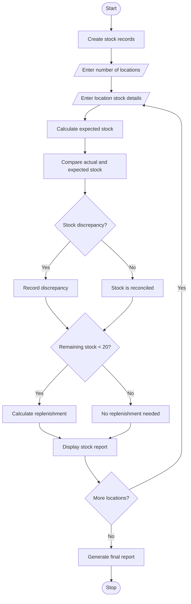

# Problem Statement
Develop a Python program to manage and reconcile food stock across multiple locations. The program compares quantities received, distributed, damaged, and remaining at each location. It identifies stock discrepancies, calculates available stock, and determines the additional quantity required for replenishment. The system helps maintain accurate food inventory records and avoid shortages.
# Assumptions
- Stock quantities are measured in kilograms (kg).
- Each location has a recorded opening stock.
- Received quantity is added to opening stock.
- Distributed and damaged quantities are subtracted.
- Expected stock = Opening stock + Received − Distributed − Damaged.
- Minimum required stock = 20 kg.
- Replenishment is required when remaining stock is below 20 kg.
- A discrepancy occurs when actual stock differs from expected stock.
# Algorithm
1. Start the program.
2. Create a list to store location details.
3. Enter the number of locations.
4. For each location, input:
   - Location name.
   - Food item name.
   - Opening stock.
   - Received quantity.
   - Distributed quantity.
   - Damaged quantity.
   - Actual remaining stock.
5. Calculate expected remaining stock.
6. Compare expected stock with actual stock.
7. Identify stock discrepancies.
8. Calculate replenishment quantity.
9. Display stock details for each location.
10. Generate the final reconciliation report.
11. Stop the program.
# mermaid flow chart

 # Conclusion
The Food Supply Chain Stock Reconciliation program helps manage food inventory across multiple locations. It calculates expected stock, identifies discrepancies, tracks damaged and distributed quantities, and determines replenishment requirements. This system improves inventory accuracy and helps prevent food shortages.
