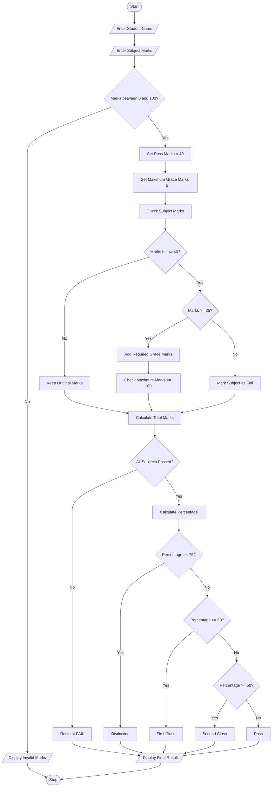

# Problem Statement
To develop a Python program for an Examination Result and Grace-Mark Validation System. The system processes marks obtained by students in multiple subjects, checks subject-wise pass criteria, applies grace marks according to a specified policy, and generates the final result classification. It ensures that grace marks do not exceed the maximum marks of any subject.
# Assumptions
3. The student has 5 subjects.
4. Each subject carries a maximum of 100 marks.
5. The minimum pass mark is 40 in each subject.
6. Grace marks of up to 5 marks can be awarded to a student who fails a subject.
7. Grace marks are awarded only if the student is within 5 marks of the pass mark.
8. Final marks must not exceed 100.
9. Students must pass all subjects to be classified as PASS.
10. Result classification:
   - 75% and above – Distinction.
   - 60% to 74% – First Class.
   - 50% to 59% – Second Class.
   - 40% to 49% – Pass.
   - Otherwise – Fail.
# Algorithm
4. Start the program.
5. Enter the student name.
6. Enter marks in five subjects.
7. Validate that all marks are between 0 and 100.
8. Set the minimum pass mark to 40.
9. Set the maximum grace marks to 5.
10. Check each subject's marks.
11. If marks are between 35 and 39, add grace marks to reach 40.
12. Ensure that final marks do not exceed 100.
13. Check whether the student passes all subjects.
14. Calculate total marks and percentage.
15. Generate the result classification.
16. Display subject-wise marks, grace marks, total, percentage, and result.
17. Stop the program.
# mermaid flow chart

# conclusion
The Examination Result and Grace-Mark Validation system successfully processes marks across multiple subjects. It checks subject-wise pass criteria, applies grace marks according to the given policy, and ensures that final marks do not exceed maximum marks. Finally, it calculates the percentage and generates the student's result classification accurately.
