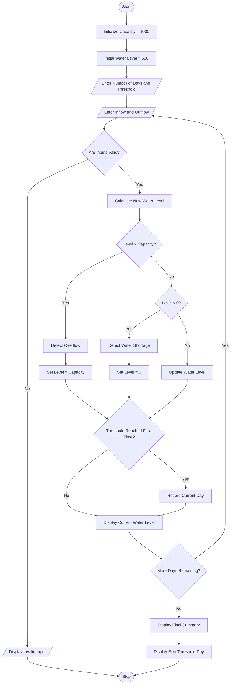

# Problem Statement
To develop a Python program for a Multi-Day Water Tank Simulation System. The system processes changing water inflow and outflow quantities over multiple days, updates the tank water level, detects overflow and water shortages, and identifies the first interval in which the water level reaches a specified threshold.
# Assumptions
3. The tank capacity is 1000 litres.
4. The initial water level is 500 litres.
5. The number of simulation days is entered by the user.
6. Daily water inflow and outflow are entered separately.
7. Water inflow and outflow cannot be negative.
8. If the water level exceeds 1000 litres, overflow is detected.
9. If the outflow exceeds available water, a shortage is detected.
10. The threshold water level is 800 litres.
11. The first day on which the water level reaches or exceeds the threshold is recorded.
12. Water level cannot exceed tank capacity or fall below zero.
# Algorithm
14. Start the program.
15. Initialize tank capacity to 1000 litres.
16. Set initial water level to 500 litres.
17. Initialize threshold day to -1.
18. Enter the number of simulation days.
19. Enter the required threshold level.
20. For each day, enter water inflow and outflow.
21. Validate the inflow and outflow values.
22. Calculate the new water level using:
New Level = Previous Level + Inflow - Outflow
10. If the new level exceeds tank capacity, detect overflow and set the level to 1000 litres.
11. If the new level is below zero, detect shortage and set the level to zero.
12. Otherwise, update the water level normally.
13. Check whether the threshold is reached for the first time.
14. Display the daily water level and warnings.
15. Display the final water level and first threshold-reaching day.
16. Stop the program.
# mermaid flow chart

# conclusion

print("===== WATER TANK SIMULATION =====")

capacity = 1000
water_level = 500
threshold_day = -1

days = int(input("Enter number of days: "))
threshold = float(input("Enter threshold level: "))

# Validate threshold and number of days
if days <= 0 or threshold < 0 or threshold > capacity:
    print("Invalid days or threshold")

else:
    for day in range(1, days + 1):

        print("\nDay", day)

        inflow = float(input("Enter water inflow: "))
        outflow = float(input("Enter water outflow: "))

        # Validate water quantities
        if inflow < 0 or outflow < 0:
            print("Invalid Input")
            break

        # Calculate water level
        new_level = water_level + inflow - outflow

        # Check overflow
        if new_level > capacity:
            print("Overflow Detected!")
            water_level = capacity

        # Check shortage
        elif new_level < 0:
            print("Water Shortage Detected!")
            water_level = 0

        else:
            water_level = new_level

        print("Current Water Level:", water_level, "litres")

        # Find first threshold interval
        if water_level >= threshold and threshold_day == -1:
            threshold_day = day

    else:
        print("\n===== FINAL SUMMARY =====")

        print("Final Water Level:", water_level, "litres")

        if threshold_day != -1:
            print("Threshold Reached on Day:", threshold_day)
        else:
            print("Threshold Not Reached")

        print("Simulation Completed")

