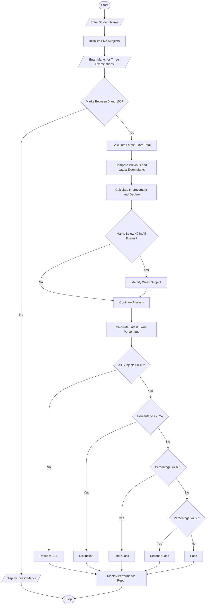

# problem statement
To develop a Python program for Student Performance Trend Analysis. The system compares student assessment scores across multiple examinations, calculates improvements and declines in marks, identifies consistently weak subjects, and classifies students according to their overall academic performance. It helps students and teachers understand academic progress and identify subjects that need improvement.
# assumption
1. Each student has five subjects: Python, Mathematics, English, Physics, and Chemistry.
2. Each subject carries a maximum of 100 marks.
3. The student attends three examinations.
4. Marks must be between 0 and 100.
5. Improvement or decline is calculated by comparing the latest examination with the previous examination.
6. A subject is considered consistently weak if marks are below 40 in all three examinations.
7. Students must score at least 40 in every subject in the latest examination to pass.
8. Classification is based on the latest examination percentage:
   - 75% and above – Distinction.
   - 60% to 74% – First Class.
   - 50% to 59% – Second Class.
   - 40% to 49% – Pass.
   - Below 40% in any subject – Fail.
 # algorithm
1. Start the program.
2. Enter the student name.
3. Initialize five subjects.
4. Enter marks for three examinations in each subject.
5. Validate that all marks are between 0 and 100.
6. Calculate the total marks of the latest examination.
7. Compare the second and third examination marks.
8. Calculate improvements and declines for each subject.
9. Identify subjects in which marks are below 40 in all examinations.
10. Calculate the latest examination percentage.
11. Check whether the student passed all subjects.
12. Classify the student based on the percentage.
13. Display the student's name, total marks, percentage, improvements, declines, weak subjects, and final classification.
14. Stop the program.
# mermaid flow chat

# Conclusion
The Student Performance Trend Analysis system successfully compares student marks across multiple examinations. It calculates improvements and declines, identifies consistently weak subjects, and classifies students according to their academic performance. This program helps students and teachers monitor progress, identify learning difficulties, and improve academic results using Python.
    
