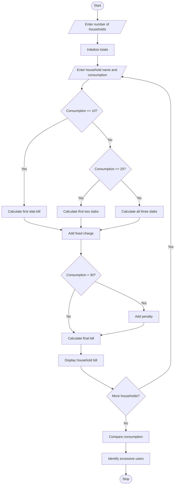

# Problem Statement
Develop a Python program to calculate water bills for multiple households based on water consumption. The program should apply different consumption slab rates, fixed charges, and penalties for excessive usage. It should compare household consumption patterns, identify households with high water usage, and display the final bill amount for each household.
# Assumptions
- Number of households is entered by the user.
- Water consumption is measured in kilolitres (KL).
- Fixed charge = ₹50 per household.
- Consumption rates:
Consumption	Rate
First 10 KL	₹5 per KL
Next 10 KL	₹8 per KL
Above 20 KL	₹12 per KL
- Excess usage penalty = ₹100 if consumption exceeds 30 KL.
- Excessive usage limit = 30 KL.
# Algorithm
1. Start the program.
2. Read the number of households.
3. Initialize total consumption and highest consumption.
4. For each household:
   - Read household name.
   - Read water consumption.
   - Calculate the bill using progressive slabs.
   - Add fixed charges.
   - Apply penalty if consumption exceeds 30 KL.
   - Display the final bill.
5. Compare household consumption.
6. Identify excessive water users.
7. Display total consumption and highest usage.
8. Stop the program.
#  mermaid flow chart

# sample input
Enter number of households: 3

Household 1
Enter household name: Ravi
Enter water consumption (KL): 8

Household 2
Enter household name: Kumar
Enter water consumption (KL): 15

Household 3
Enter household name: Sita
Enter water consumption (KL): 35
