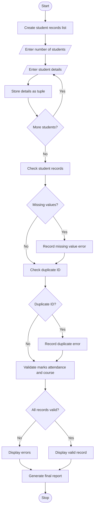

# Problem Statement
Develop a Python program to validate student records stored using lists and tuples. The program checks student IDs, names, marks, attendance, and course details. It identifies duplicate student IDs, missing values, invalid marks, insufficient attendance, and inconsistent academic records. Finally, it displays valid and invalid student records with error details.
# Assumptions
- Student ID must be unique.
- Student name cannot be empty.
- Marks must be between 0 and 100.
- Attendance must be between 0 and 100%.
- Course name cannot be empty.
- Minimum attendance requirement is 75%.
- Student records are stored as tuples inside a list.
- Missing values are represented using an empty string or None.
# Algorithm
1. Start the program.
2. Create a list to store student records.
3. Enter the number of students.
4. Read student ID, name, marks, attendance, and course.
5. Store each student's information as a tuple.
6. Check each student record:
   - Check for missing values.
   - Check duplicate student IDs.
   - Validate student name.
   - Validate marks.
   - Validate attendance.
   - Validate course details.
7. Separate valid and invalid records.
8. Display errors for invalid records.
9. Display the final consistency report.
10. Stop the program.
# mermaid flow chart

# conclusion
the Integrated Student Record Consistency Checker successfully validates student information stored in lists and tuples. It detects duplicate IDs, missing values, invalid marks, low attendance, and incorrect course details. This program helps maintain accurate student records and improves academic data management.

